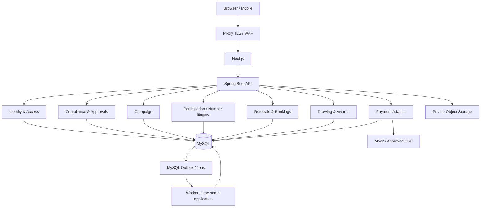

# IMPLEMENTATION_PLAN.md — Implementação integral da plataforma de campanhas autorizadas

**Versão:** 1.0 · **Data:** 2026-10-29 · **Idioma:** PT-BR · **Executor:** agente Codex supervisionado  
**Contrato do agente:** [`AGENTS.md`](./AGENTS.md) · **Descoberta automática do Codex:** [`AGENTS.md`](./AGENTS.md)

> **Objetivo:** entregar aplicação web completa, segura e auditável para campanhas promocionais e operações filantrópicas **legalmente autorizadas com embasamento de AÇÃO ENTRE AMIGOS**, inicialmente em modo demonstração; integrar pagamentos reais apenas quando a modalidade aprovada permitir arrecadação. Isto **não** é um projeto de venda de bilhetes de rifa particular para benefício privado, mas uma campanha de Ação entre amigos, para investimento em equipamentos novos para a criação de um novo modelo de trabalho. 

## 0. Instrução inicial ao Codex

Ao iniciar, o Codex deve executar este plano como backlog rastreável, sem fingir que um checkbox equivale a uma implementação. O agente deve:

1. Inspecionar a árvore atual e verificar se é repositório vazio ou existente; preservar código e arquivos existentes.
2. Ler `AGENTS.md`, `AGENT.md` e este plano integralmente.
3. Criar `docs/progress/P00.md` e iniciar pelo marco P00.
4. Trabalhar uma fase por vez; atualizar `[ ]` para `[x]` apenas quando houver evidência e testes correspondentes.
5. Usar `DEMO` como modo inicial. Qualquer dependência de autorização, certificado ou ação é registrada como **bloqueio de produção**, não como motivo para construir cobranças não autorizadas.
6. Ao terminar cada fase, rodar os testes pertinentes, registrar resultados e manter a próxima fase implementável.
7. Após P20, gerar relatório final com funcionalidades implementadas, comandos reprodutíveis, resultados de testes, riscos remanescentes e gates de ativação pendentes.

### Definição de concluído (DoD) geral

Uma tarefa só pode ser marcada concluída se tiver implementação funcional (não stub), testes automatizados adequados, documentação/contratos atualizados, logs sanitizados, autorização por papel/recurso, UX acessível e revisão de regressão. Para itens de infraestrutura ou integração, acrescentar demonstração reprodutível. Gates externos nunca são marcados como concluídos por decisão do Codex.

---

## 0.1. Status de execução (2026-11-01)

> Visão consolidada para agentes/programadores. Detalhes por fase abaixo e em `docs/progress/`.

### Implementado e na `main`
- **P00–P12, P13, P14, P15, P16, P18** (e **P07-A** carga inicial de prêmios) com `./mvnw -B verify` verde.
  PRs #1–#26 mergeados.
- **P16** (hardening/LGPD/red-team interno), **P18** (carga/recuperação, alto volume) e **CPF do
  contemplado** (cifrado, só para prêmio, `V022`).

### Decisões dos gates registradas (docs)
- `docs/decisions.md` (D-001…D-008; D-OPEN-002/004/005/006/007/010/011/012/013 resolvidos).
- `docs/adr/ADR-0007` (modalidade), `ADR-0008` (retenção CPF/rotação de chaves), `ADR-0009`
  (red-team interno + aceitação de risco).
- `docs/compliance/gates-status.md`, `docs/compliance/risk-acceptance.md`.

### ADR-0007 — execução
- Implementado o modo **`CAPITALIZATION_PRIZE_TITLE`** (ver **P05-A** abaixo). Cobrança e prêmio em
  dinheiro **somente** com autorização SUSEP **verificada e vigente** + todos os gates aprovados.
- **Cobrança permanece sandbox** (`MockPaymentProvider`); `LIVE_OPERATIONS_ENABLED=false`.

### Pendências que bloqueiam PRODUÇÃO REAL (não o MVP/DEMO)
- `D-OPEN-001` titular; `D-OPEN-003` equipamentos; `D-OPEN-008` fórmula fechada da apuração;
  `D-OPEN-009` data/concurso da Federal; `D-OPEN-014` contrato/homologação do PSP e do emissor.
- Anexar **documento SUSEP** + **regulamento versionado** à campanha; `G-*` restantes no
  `gates-status.md`; assinatura do Termo de Aceitação de Risco.
- Frontend: alinhar preços (base R$ 1,00; combos 5/13/26/31%), `entityId` obrigatório e telas de
  transparência/apuração.

### MVP local
- Como rodar: `docs/operations/local-mvp.md` (Docker Compose + backend profile `local` + frontend).

---

# 1. Visão do produto e especificação comercial de referência

## 1.1. Produto

Aplicação web responsiva, inicialmente orientada a uma campanha de kit de fotografia, com:

- Landing page e catálogo de bens/prêmios com fotos e descrições verdadeiras.
- Cadastro, login, consentimentos, elegibilidade, histórico e comprovantes.
- Sistema de elementos sorteáveis numéricos de cinco dígitos.
- Indicações com URLs identificáveis e métricas auditáveis.
- Rankings em tempo real aproximado, com snapshots definitivos no encerramento.
- Integração simulada e, quando permitida, real com Pix por PSP homologado.
- Motor de apuração auditável vinculado à Loteria Federal na forma do regulamento autorizado.
- Seleção predeterminada e verificável de dez números-surpresa, **somente se a mecânica e premiação forem aprovadas**.
- Administração de campanhas, documentos jurídicos, auditoria, relatórios e entrega de prêmios.
- Histórico financeiro e prestação de contas, conforme modalidade.

## 1.2. Premiação e orçamento propostos (não aprovados)

| ID | Descrição | Valor estimado | Condição para produção |
|---|---|---:|---|
| AW-01 | Kit fotográfico: câmera Canon D70, lente Canon profissional 24-70 1:4, flash 430EX e acessórios | R$ 10.000,00 | Titularidade, documentação, valor comprovável e autorização para o bem |
| AW-02 | Macbook Air M1 13" 8 GB | R$ 4.000,00 | Titularidade, documentação, valor comprovável e autorização para o bem |
| AW-03 | Kit fotográfico: câmera Canon T1i Rebel e acessórios | R$ 2.000,00 | Titularidade, documentação, valor comprovável e autorização para o bem |
| AW-04 | Quarto número sorteado | R$ 1.000,00 | **Não disponibilizar em dinheiro na promoção comercial** |
| AW-05 | Quinto número sorteado | R$ 500,00 | **Não disponibilizar em dinheiro na promoção comercial** |
| AW-06 | Dez prêmios-surpresa de R$ 100 cada, em números aleatórios gerados na inicialização do sistema, fixos e com snapshot auditável | R$ 1.000,00 | Premiação/mecânica devem ser expressamente permitidas; dinheiro proibido em promoção comercial |
| **Total** | **Orçamento original** | **R$ 18.500,00** |  |

O produto deve permitir **substituir prêmios pecuniários por bens permitidos** quando juridicamente validado e registrado no regulamento. Não simular Pix de prêmio como se fosse uma funcionalidade de produção de promoção comercial.

## 1.3. Capacidade e forma de numeração

- Intervalo solicitado originalmente: `00001` a `99999`, equivalendo a 99.999 posições.
- Suporte técnico recomendado: `00000` a `99999`, equivalendo a 100.000 posições e cinco dígitos padronizados.
- A escolha do intervalo depende do documento aprovado. **Não criar uma regra substitutiva quando o número `00000` ou outro número não atribuído surgir** sem cláusula expressa no regulamento.
- Um elemento é identificável por `campaign_id + number_value`, com representação visível `String.format("%05d", number)`.
- A distribuição de elementos em promoções comerciais deve seguir o método aleatório, equitativo e autorizado. A UI não deve supor escolha livre de número ou compra de números.
- Prever mais de uma série somente se necessária, com modelagem explícita (`series_code`, `number_value`) e plano específico; o MVP usa uma série.

## 1.4. Perfis e permissões

| Papel | Responsabilidades | Restrições |
|---|---|---|
| `VISITOR` | Navegar em campanhas públicas e regulamentos | Sem PII ou números privados de terceiros |
| `PARTICIPANT` | Gerenciar perfil e participações elegíveis | Sem alteração de condições, pagamentos, apuração |
| `PROMOTER` | Criar e acompanhar links próprios de divulgação | Sem acesso a CPF de pessoas indicadas |
| `SUPPORT` | Atender solicitações e registrar ocorrências | Não cria pagamentos, não altera sorteio |
| `CAMPAIGN_MANAGER` | Preparar campanhas, bens e cronograma | Não aprova sozinho autorização ou sorteios |
| `FINANCE` | Conciliação e relatórios financeiros | Não modifica condições de sorteio |
| `COMPLIANCE_REVIEWER` | Revisar documentação e aderência legal | Não pode aprovar a própria submissão |
| `DRAW_AUDITOR` | Validar fonte oficial, snapshots e apuração | Não pode criar/modificar participação |
| `SECURITY_ADMIN` | Segurança e gestão de acessos | Sem privilégios implícitos para editar prêmios |
| `SYSTEM_ADMIN` | Administração controlada da plataforma | Ações críticas exigem dupla aprovação |

Todos os acessos a recursos devem validar proprietário/organização/campanha, e não apenas papel global.

---

# 2. Enquadramento operacional e gates de legalidade

## 2.1. Modos de execução

| Modo | Pode usar dados simulados? | Cobranca Pix real? | Campanha pública real? |
|---|---|---|---|
| `DEMO` | Sim, sinalizando demonstração | **Não** | **Não** |
| `COMMERCIAL_PROMOTION` | Em homologação, sim | **Não cobrar participação** | Só com autorização e todas as exigências |
| `PHILANTHROPIC_AUTHORIZED` | Em homologação, sim | Possível, **se aprovado e aceito pelo PSP** | Só com autorização aplicável, entidade elegível, premiação e destinação válidas |

Outras modalidades não são ativáveis pelo painel. Demandam projeto/ADR e novo parecer. Não introduzir `PRIVATE_PAID_RAFFLE` em produção.

## 2.2. Portas de aprovação

`G-LEGAL` (modalidade e autorização), `G-PSP` (aceite e contrato), `G-FINANCE` (tributação/destinação), `G-SECURITY`, `G-OPERATIONS` e `G-LAUNCH` são avaliadas no backend. Não são equivalentes ao simples checkbox da UI.

Uma campanha só pode tornar-se pública e receber participações reais quando:

```text
canOpenRealCampaign(campaign) =
    globalLiveOperationsEnabled
    AND campaign.mode != DEMO
    AND campaign.authorization.isVerifiedAndInScope
    AND campaign.regulation.isApprovedVersion
    AND campaign.prizes.allAllowedForMode
    AND campaign.operator.isEligibleForMode
    AND requiredHumanApprovals.areComplete
    AND campaign.currentTime.withinApprovedWindow
    AND externalProviderAcceptance.ifRequired
    AND campaign.status == SCHEDULED
```

**Separar `legalAuthorization` e `humanApproval`:** upload de PDF não comprova autenticidade. Dois revisores diferentes devem validar registro, titular, escopo, datas, valores e fonte oficial; permitir revogação e suspensão. Uma operação filantrópica exige provas específicas da organização e doações dos bens, conforme aplicável.

## 2.3. Itens bloqueados até validação específica

- Cobrança de números por pessoa física como rifa particular.
- Prêmios em dinheiro, Pix ou conversíveis em dinheiro em promoções comerciais.
- Competições de "quem comprou mais números" em modalidade onde a cobrança não é permitida.
- Comissões de divulgação disfarçadas de prêmio em dinheiro; exigir contrato e classificação tributária quando houver remuneração por serviço.
- Dez prêmios-surpresa em dinheiro e escolha arbitrária posterior dos contemplados.
- Divulgação/publicidade de campanha que ainda não possua autorização exigida.
- Uso de imagens de bens não próprios, alegações enganosas de valor ou autenticidade e resultados artificiais.

## 2.4. Documentos de compliance e transparência

Implementar armazenamento privado e versionado de: documentos do organizador, prova de titularidade/doação da câmera e acessórios, laudo/nota e valor dos bens, regulamento, plano de operação, comprovante de autorização, aceite do PSP, dados de responsável, política de privacidade, registros de consentimento, comprovantes de entregas, relatório de apuração e prestação de contas.

O site público mostra apenas documentos autorizados para divulgação, identificação de promotor e registro regulamentar. Não expor documentos privados na rede pública.

---

# 3. Stack, versões, infraestrutura e desenho técnico

## 3.1. Escolhas

| Camada | Tecnologia e premissas |
|---|---|
| Backend | Java 25, Spring Boot 4.x estável, Spring MVC, Spring Security 7.x via BOM, Maven Wrapper |
| UI | Next.js estável compatível, React 19, TypeScript strict, Tailwind, componentes acessíveis |
| Validação frontend | Zod + tipos gerados da especificação OpenAPI |
| Banco | MySQL 8.4 LTS, InnoDB, migrações Flyway |
| Banco em testes | Testcontainers/MySQL e dados determinísticos |
| Jobs/outbox | MySQL, polling transacional `FOR UPDATE SKIP LOCKED` para filas |
| Webhooks | Endpoint autenticado + inbox/outbox + reconciliação periódica |
| Armazenamento | API compatível com S3 (ex.: MinIO local), criptografia para objetos privados |
| Observabilidade | Actuator, Micrometer, OpenTelemetry, logs estruturados, alertas |
| Deploy | Docker Compose em dev/staging; deploy Linux com TLS, reverse proxy e backups verificados |
| Testes | JUnit 5, AssertJ, Spring Boot Test, Playwright, Vitest ou equivalente |

Não adicionar Redis, Kafka, Kubernetes, filas gerenciadas ou microsserviços sem ADR e necessidade demonstrada. Preferir um serviço de aplicação e um frontend separados.

## 3.2. Diagrama funcional



## 3.3. Ambientes

| Ambiente | Banco | Provedor Pix | Dados | Operação real |
|---|---|---|---|---|
| `local` | MySQL em container | Mock | Seed fictício | Não |
| `ci` | Testcontainers | Fake in-memory | Fictício | Não |
| `staging` | MySQL isolado | Sandbox ou Mock | Sintético | Não |
| `production` | MySQL privado | PSP autorizado e validado | Real com LGPD | Apenas gates satisfeitos |

Configurar `LIVE_OPERATIONS_ENABLED=false` como padrão mesmo em produção inicialmente; habilitar apenas com checklist assinado e dupla aprovação. O adaptador `MockPaymentProvider` deve recusar uso quando `production=true` e houver cobrança real.

---

# 4. Modelo de dados relacional e invariantes

Os nomes de tabelas abaixo são contratuais em termos conceituais. Migrações reais devem conter colunas de auditoria, `created_at`, `updated_at`, `version`, índices e constraints apropriadas. Tipos monetários: `BIGINT amount_cents`, `CHAR(3) currency`, sem `FLOAT`.

## 4.1. Identidade / organizações

| Tabela | Campos essenciais / restrições |
|---|---|
| `organizations` | `id`, `legal_name`, `tax_id_encrypted`, `tax_id_lookup_hash`, `type`, `status` |
| `users` | `id`, `display_name`, `email_normalized`, `email_verified_at`, `status`, `created_at` |
| `user_identity` | `user_id UNIQUE`, `cpf_ciphertext`, `cpf_lookup_hash UNIQUE` escopado, `birth_date_ciphertext`, `verification_state` |
| `memberships` | `organization_id`, `user_id`, `role`, `status`, UNIQUE por papel |
| `webauthn_credentials` | `id`, `user_id`, `credential_id UNIQUE`, `public_key`, `sign_count`, `last_used_at` |
| `sessions` | `id`, `user_id`, `expires_at`, `revoked_at`, `device_metadata_minimal` |
| `consent_receipts` | `user_id`, `policy_version`, `purpose`, `legal_basis_ref`, `accepted_at`, `evidence` |
| `privacy_requests` | `user_id`, `request_type`, `status`, `response_deadline`, `resolved_at` |

## 4.2. Campanhas / compliance

| Tabela | Campos essenciais / restrições |
|---|---|
| `campaigns` | `id`, `organization_id`, `slug UNIQUE`, `mode`, `status`, `title`, `starts_at`, `ends_at`, `timezone`, `series_count`, `number_min`, `number_max`, `current_regulation_id`, `version` |
| `campaign_regulations` | `id`, `campaign_id`, `version`, `document_sha256`, `document_uri`, `approved_at`, `approval_status`, UNIQUE(campaign_id, version) |
| `campaign_authorizations` | `id`, `campaign_id`, `issuer`, `certificate_no`, `valid_from`, `valid_to`, `approval_scope_json`, `document_uri`, `verified_at`, `status` |
| `compliance_documents` | `id`, `organization_id`, `campaign_id`, `kind`, `object_key`, `sha256`, `classification`, `status` |
| `approval_requests` | `id`, `campaign_id`, `gate_type`, `requested_by`, `status`, `requested_at`, `resolved_at` |
| `approval_decisions` | `id`, `request_id`, `reviewer_user_id`, `decision`, `reason`, `decided_at`; vedar autoaprovação |
| `campaign_prizes` | `id`, `campaign_id`, `type`, `description`, `value_cents`, `quantity`, `eligibility_rule_id`, `status` |
| `campaign_assets` | `id`, `campaign_id`, `storage_key`, `alt_text`, `license_status`, `sort_order` |

## 4.3. Participações e números

| Tabela | Campos essenciais / restrições |
|---|---|
| `campaign_numbers` | `id`, `campaign_id`, `series_code`, `number_value`, `status`, `entry_id NULL`, `version`; UNIQUE(campaign_id, series_code, number_value) |
| `participation_requests` | `id`, `campaign_id`, `user_id`, `idempotency_key`, `requested_count`, `status`, `created_at`; UNIQUE(campaign_id,user_id,idempotency_key) |
| `participation_entries` | `id`, `campaign_id`, `user_id`, `status`, `eligibility_snapshot_hash`, `issued_at`, `validated_at`, `source`; ver ligação a números |
| `entry_number_assignments` | `entry_id`, `campaign_number_id UNIQUE`, `assigned_at`, PK(entry_id,campaign_number_id) |
| `eligibility_events` | `id`, `entry_id`, `rule_version`, `result`, `reason_code`, `checked_at` |
| `reservation_leases` | `id`, `campaign_id`, `number_id`, `request_id`, `expires_at`, `status`, `version`; somente se o modo e plano legal exigirem reserva |

Não implementar atribuição por `SELECT MAX(number_value)+1` sem mecanismo correto de sincronização. Para sorteios gratuitos sujeitos a equidade, preferir algoritmo aprovado com permutação única gerada de forma segura, teste de distribuição e atribuição transacional; evitar dizer que um PRNG garante conformidade sem revisão.

## 4.4. Pagamentos (somente modelo autorizado)

| Tabela | Campos essenciais / restrições |
|---|---|
| `orders` | `id`, `campaign_id`, `user_id`, `status`, `total_cents`, `mode`, `expires_at`, `idempotency_key` |
| `order_items` | `id`, `order_id`, `description`, `quantity`, `unit_amount_cents`, `reference_id` |
| `payments` | `id`, `order_id`, `provider`, `provider_charge_id UNIQUE`, `txid UNIQUE` por conta PSP, `status`, `amount_cents`, `confirmed_at` |
| `payment_events` | `id`, `payment_id`, `provider_event_id`, `end_to_end_id`, `event_type`, `payload_sha256`, `received_at`, `processed_at`; unicidade por provedor/evento |
| `refunds` | `id`, `payment_id`, `provider_refund_id`, `amount_cents`, `status`, `reason`, `requested_at` |
| `financial_ledger` | `id`, `campaign_id`, `source_ref`, `entry_type`, `amount_cents`, `posted_at`; modelo imutável de eventos e ajustes compensatórios |
| `reconciliation_runs` | `id`, `provider`, `started_at`, `finished_at`, `discrepancies`, `status` |

## 4.5. Indicações, ranking, sorteios e auditoria

| Tabela | Campos essenciais / restrições |
|---|---|
| `referral_links` | `id`, `campaign_id`, `promoter_user_id`, `code UNIQUE`, `status`, `created_at` |
| `referral_clicks` | `id`, `referral_link_id`, `anonymous_id_hash`, `created_at`; retenção curta e sem IP puro persistente |
| `referral_attributions` | `id`, `campaign_id`, `referral_link_id`, `referred_user_id`, `entry_id`, `status`, `attributed_at`; UNIQUE(campaign_id, entry_id) |
| `ranking_rules` | `id`, `campaign_id`, `rule_version`, `metric`, `tie_breaker`, `legally_approved`, `effective_at` |
| `ranking_snapshots` | `id`, `campaign_id`, `ranking_rule_id`, `cutoff_at`, `snapshot_hash`, `generated_at` |
| `ranking_positions` | `snapshot_id`, `user_id`, `position`, `score`, `tiebreak_value`; PK(snapshot_id,user_id) |
| `draw_rules` | `id`, `campaign_id`, `version`, `source_kind`, `formula_json`, `fallback_json`, `approved_regulation_sha256` |
| `draws` | `id`, `campaign_id`, `draw_rule_id`, `federal_extraction_id`, `status`, `frozen_at`, `entries_merkle_root_or_hash` |
| `federal_results` | `id`, `contest_identifier`, `drawn_at`, `source_url`, `source_document_hash`, `result_payload`, `verified_by_two`, `verified_at` |
| `draw_outcomes` | `id`, `draw_id`, `prize_id`, `winning_number`, `entry_id NULL`, `decision_code`, `evidence_hash` |
| `surprise_commitments` | `id`, `campaign_id`, `commitment_sha256`, `encrypted_secret_object_key`, `committed_at`, `revealed_at`, `rule_version` |
| `award_deliveries` | `id`, `award_id`, `beneficiary_user_id`, `status`, `delivery_evidence_uri`, `delivered_at` |
| `outbox_events` | `id`, `aggregate_type`, `aggregate_id`, `event_type`, `payload_json`, `status`, `available_at`, `attempt_count`, `locked_at` |
| `inbox_events` | `id`, `source`, `source_event_id`, `payload_hash`, `received_at`, `processed_at`, UNIQUE(source,source_event_id) |
| `audit_events` | `id`, `actor_id`, `action`, `entity_type`, `entity_id`, `before_hash`, `after_hash`, `correlation_id`, `created_at`, `chain_prev_hash`, `event_hash` |

## 4.6. Constraints e queries obrigatórias

- FK sem cascade deletar histórico financeiro ou de auditoria.
- `CHECK number_value BETWEEN 0 AND 99999`, além dos limites por campanha validáveis em serviço.
- Unicidade de número de série/campanha e vinculação de número a no máximo uma participação válida.
- Unicidade de `idempotency_key` por escopo, `provider_event_id`, `end_to_end_id` quando aplicável e identificador público de sorteio.
- Versionamento otimista em mudanças administrativas; `SELECT ... FOR UPDATE` para transição monetária/crítica.
- Índices em `(campaign_id,status)`, `(campaign_id,user_id)`, `(campaign_id,number_value)`, `(status,available_at)` e chaves de reconciliação.
- Migration e reversibilidade operacional: sem apagar tabelas em produção; rollback via restore/forward-fix documentado.

---

# 5. API REST e eventos de domínio

**Prefixo:** `/api/v1` — autenticação por sessão/cookie protegido, respostas tipadas, `ProblemDetail` e `X-Correlation-ID`. Toda operação de escrita de alto impacto deve aceitar `Idempotency-Key` e/ou precondição `If-Match` quando aplicável.

| Método | Rota | Acesso | Função / restrições |
|---|---|---|---|
| GET | `/campaigns` | Público | Listar apenas campanhas realmente publicáveis, com filtros/paginação |
| GET | `/campaigns/{slug}` | Público | Detalhes e regulamento público, sem dados secretos |
| GET | `/campaigns/{slug}/prizes` | Público | Prêmios aprovados e publicáveis |
| GET | `/campaigns/{slug}/stats` | Público | Métricas permitidas, agregadas e atualizadas |
| POST | `/auth/register` | Visitante | Registro com verificação, rate limiting e dados mínimos |
| POST | `/auth/login` | Visitante | Autenticação segura, nunca devolver tokens em querystring |
| POST | `/auth/logout` | Autenticado | Revogar sessão |
| GET | `/me` | Autenticado | Perfil mínimo |
| GET | `/me/participations` | Participante | Somente participações próprias |
| POST | `/campaigns/{id}/participations` | Participante | Criar solicitação elegível, conforme modalidade (gratuito por padrão) |
| GET | `/campaigns/{id}/numbers/{number}` | Público/participante | Estado público agregado, sem dono/CPF; se regulamento permitir |
| POST | `/campaigns/{id}/referrals` | Divulgador elegível | Criar link próprio com antiabuso |
| GET | `/me/referrals` | Divulgador | Estatísticas pessoais sem expor usuários terceiros |
| GET | `/campaigns/{id}/rankings` | Público | Snapshot e pseudônimos, quando a dinâmica for permitida |
| POST | `/campaigns/{id}/orders` | Participante elegível | **Rejeitar** em modo gratuito ou sem gate de cobrança |
| GET | `/me/orders/{id}` | Titular | Pedido próprio, quando aplicável |
| POST | `/payments/webhooks/{provider}` | PSP | Autenticação e inbox idempotente; não usar cookie/session |
| GET | `/campaigns/{id}/draws` | Público | Extratos publicáveis e evidências da apuração |
| GET | `/campaigns/{id}/draws/{drawId}/proof` | Público | Fórmula, snapshot, source hash e resultados publicáveis |
| POST | `/admin/campaigns` | Manager | Criar rascunho; sem publicar automaticamente |
| PATCH | `/admin/campaigns/{id}` | Manager | Atualização só em estados editáveis e com versão |
| POST | `/admin/campaigns/{id}/documents` | Manager | Upload protegido e hash; evitar malware/SSRF |
| POST | `/admin/campaigns/{id}/submit-for-review` | Manager | Submeter revisão |
| POST | `/admin/approvals/{id}/decision` | Reviewer | Aprovação/rejeição com justificativa e segregação |
| POST | `/admin/campaigns/{id}/schedule` | Manager + gates | Validar autorização e regras |
| POST | `/admin/campaigns/{id}/open` | Admin com dupla aprovação | Falha segura se falta gate |
| POST | `/admin/campaigns/{id}/freeze` | Manager + Auditor | Congelar snapshot |
| POST | `/admin/draws/{id}/official-results` | Auditor | Importar evidências sob dupla revisão |
| POST | `/admin/draws/{id}/compute` | Auditor | Apuração determinística, sem edição de regra |
| POST | `/admin/draws/{id}/publish` | Dois aprovadores | Publicar resultado verificado |
| GET | `/admin/reports/financial` | Finance | Conciliado, exportação sob autorização |
| GET | `/admin/reports/audit` | Auditor | Exports auditáveis, PII minimizada |
| POST | `/privacy/requests` | Titular | Exercício de direitos LGPD |

### 5.1. Exemplo de erro

```json
{
  "type": "https://example.invalid/problems/campaign-not-authorized",
  "title": "Campanha não autorizada para operação real",
  "status": 403,
  "detail": "A participação real está indisponível até a conclusão das aprovações aplicáveis.",
  "code": "CAMPAIGN_OPERATION_BLOCKED",
  "correlationId": "corr-demo-123"
}
```

### 5.2. Eventos internos

`CampaignCreated`, `RegulationApproved`, `AuthorizationVerified`, `CampaignOpened`, `ParticipationRequested`, `EligibilityApproved`, `NumbersAssigned`, `PaymentConfirmed`, `PaymentRefunded`, `ReferralAttributed`, `CampaignFrozen`, `OfficialResultVerified`, `DrawingComputed`, `DrawingPublished`, `AwardDeliveryRecorded`, `PrivacyRequestSubmitted`.

Eventos são registrados na mesma transação do dado de negócio por outbox e processados ao menos uma vez com consumidor idempotente. Não prometer "exactly once" em rede distribuída.

---

# 6. Máquina de estados e fluxos críticos

## 6.1. Ciclo de vida da campanha

```text
DRAFT -> LEGAL_REVIEW -> AUTHORIZED -> SCHEDULED -> OPEN
   \          \               \                    |
    -> CANCELLED <------------ SUSPENDED <----------+
                                                 |
OPEN -> LOCKED -> DRAW_PENDING -> DRAWN -> AWARDS_PENDING -> CLOSED
           \             \              \
            -> CANCELLED   -> SUSPENDED   -> SUSPENDED
```

Transições devem ser verificadas em `CampaignStateMachine` com permissões e versões. `AUTHORIZED` é estado **documental verificado por humanos**, não inferência automática do Codex; regras de suspensão e encerramento antecipado devem obedecer ao regulamento e procedimentos aplicáveis. O estado `DEMO` é modo operacional, não um estado dessa máquina.

## 6.2. Participações

```text
REQUESTED -> ELIGIBILITY_PENDING -> ELIGIBLE -> ASSIGNED -> FROZEN
       \                    \          \
        -> REJECTED          -> REJECTED -> INVALIDATED (com trilha de auditoria)
```

Caso filantrópico com pagamento permitido, a etapa de elegibilidade pode exigir `PAYMENT_CONFIRMED`, mas não se pode equiparar automaticamente pagamento a autorização. Em promoção gratuita, o fluxo não pode exigir pagamento nem compra de bilhete. Ao congelar, participantes elegíveis e números são serializados em ordem canônica e hasheados.

## 6.3. Pedido/pagamento sob modalidade aprovada

```text
CREATED -> AWAITING_PAYMENT -> CONFIRMED -> RECONCILED
    \             \             \
     -> CANCELLED  -> EXPIRED    -> REFUND_PENDING -> REFUNDED
```

`EXPIRED` não invalida uma liquidação real sem análise; tratar pagamentos tardios e concessão de participação segundo regulamento. Ledger de ajustes nunca remove o lançamento original.

## 6.4. Rankings e desempates

- Métrica e horário de corte devem constar de `ranking_rules` aprovadas.
- Ranking de divulgadores: contar exclusivamente indicações elegíveis e validadas, não cliques.
- Ranking de participantes: oferecer apenas se juridicamente permitido para aquela modalidade e regras; em promoção comercial gratuita não exibir incentivo por gasto.
- Desempate: regra predeterminada e auditável (ex.: momento da última participação elegível), **apenas se aprovada**; não alterar após o início.
- Recalcular materializado periodicamente e produzir snapshot definitivo congelado antes da apuração. Reconciliar com fonte transacional.

## 6.5. Resultado oficial da Loteria Federal

- Extrair apenas dados verificáveis, sem depender de site não oficial como fonte primária.
- Importação manual com dupla revisão se integração oficial não for viável ou não houver API; guardar URI, hora de consulta, documento/hashes e autores.
- A fórmula de derivação dos cinco dígitos deve ser definida por versão **do regulamento**, não por conveniência de implementação.
- Caso `winning_number` não exista/esteja indistribuído, aplicar exclusivamente a contingência documentada. Sem regra, suspender apuração e pedir definição legal (não sortear novamente arbitrariamente).
- Se extração for adiada, usar a regra aprovada para adiamento; registrar evento.
- Provar reprodutibilidade: mesmos inputs e mesma versão do regulamento => mesmo output.

## 6.6. Surpresa com compromisso criptográfico

Definição canônica conceitual:

```text
canonical = JSON_CANONICAL({
  campaignId, regulationVersion, numberRange, surpriseNumbersSorted,
  randomSaltHex, committedAt
})
commitment = SHA256(UTF8(canonical))
```

- Gerar segredo e números com fonte criptograficamente segura, conforme mecanismo aprovado.
- Publicar compromisso antes da abertura; guardar conteúdo completo com criptografia de envelope e política de acesso.
- Na data regulada, revelar conteúdo e recalcular hash; público pode verificar sem acreditar no operador.
- Falha de compromisso suspende publicação e gera incidente; **não** regenerar silenciosamente os números.
- Se premiações-surpresa não forem autorizadas, recurso permanece somente no simulador `DEMO` com marca d'água.

---

# 7. UX/UI e rotas do frontend

## 7.1. Mapa de páginas

**Públicas**

- `/` — introdução, campanhas realmente publicáveis, prova social somente verificada.
- `/campanhas/[slug]` — vitrine do kit fotográfico, galeria, acessórios, valor de referência fundamentado, premiações permitidas, regulamento e dados de autorização.
- `/campanhas/[slug]/como-participar` — mecânica correta da modalidade e FAQ.
- `/campanhas/[slug]/numeros` — busca/status permitido e visão agregada sem revelar titulares.
- `/campanhas/[slug]/ranking` — ranking aprovado, pseudônimos, métrica, horário de atualização.
- `/campanhas/[slug]/resultado` — resultado oficial + fórmula + provas públicas.
- `/legal/privacidade`, `/legal/termos`, `/legal/cookies`, `/acessibilidade`, `/contato`.

**Autenticadas**

- `/entrar`, `/cadastro`, `/verificar-email`, `/recuperar-acesso`, `/passkeys`.
- `/painel` — participações, pendências, comprovantes e notificações.
- `/painel/indicacoes` — link, QR de compartilhamento (não de pagamento), estatísticas e regras.
- `/painel/participacoes`, `/painel/privacidade`, `/painel/seguranca`.
- `/painel/pedidos` e `/painel/pedidos/[id]` — somente quando cobranças forem permitidas.

**Administração**

- `/admin` — visão consolidada e status de gates.
- `/admin/campanhas`, `/admin/campanhas/nova`, `/admin/campanhas/[id]/editar`.
- `/admin/campanhas/[id]/autorizacoes`, `/regulamento`, `/premios`, `/numeros`.
- `/admin/campanhas/[id]/indicacoes`, `/rankings`, `/sorteio`, `/premiacoes`.
- `/admin/financeiro`, `/admin/conciliacao`, `/admin/auditoria`, `/admin/usuarios`, `/admin/seguranca`.

## 7.2. Experiência mobile-first

- Em 360px, nenhuma aba comprimida com texto vertical; tabs horizontais com scroll/snap ou navegação secundária que permita toque de pelo menos 44px.
- Composição de produto: capa com foto principal, descrição concisa, conteúdo expandível, imagens reais com alt text e aspecto preservado.
- Banner de modo demonstração visualmente inequívoco; botões de cobrança ausentes ou bloqueados quando modo não permite.
- Barra fixa inferior apenas para ação elegível permitida, nunca para pressionar compras não permitidas.
- Suporte completo a teclado e screen reader; formulários com labels e validação explicativa; feedback de erros.
- Evitar marketing enganoso: contadores reais e verificáveis, sem números fictícios apresentados como reais.
- SEO com metadados, sitemap, Open Graph e JSON-LD de produto somente com informações factuais.

## 7.3. Componentes-base

`CampaignHero`, `PrizeGallery`, `CampaignStatus`, `AuthorizationBadge`, `RegulationViewer`, `ParticipationForm`, `NumberGridVirtualized`, `NumberLookup`, `PaymentStatus`, `ReferralShareCard`, `RankingTable`, `DrawingProof`, `SurpriseCommitment`, `AwardDeliveryStatus`, `AdminGateMatrix`, `AuditEventTimeline`, `FinancialDashboard`, `ConsentManager`.

Garantir skeleton/erro/empty state, loading assíncrono, mensagens localizadas, não expor dados pessoais em bibliotecas de analytics.

---

# 8. Requisitos não funcionais e métricas verificáveis

| Categoria | Meta mínima de aceitação (ambiente de homologação definido) |
|---|---|
| Integridade | Zero números duplicados/atribuídos duas vezes em 100.000 posições e teste concorrente |
| Idempotência | 100% dos webhooks replayed mantêm no máximo um efeito de domínio |
| Concorrência | Testar 100, 250 e 500 requisições paralelas; sem violação de unicidade |
| API pública | p95 < 500ms sob carga de referência documentada, excluindo PSP externo |
| Alocação | p95 < 1,5s em 100 requisições concorrentes, em infraestrutura definida |
| Frontend | LCP mobile ideal <= 2,5s e CLS <= 0,1 em páginas públicas representativas |
| Disponibilidade | Objetivo inicial 99,5% ao mês, com monitoramento e resposta a incidentes |
| Recuperação | RPO <= 15min e RTO <= 4h **somente se demonstrados no teste de restauração** |
| Segurança | Nenhum finding crítico/alto sem mitigação e aceite formal |
| Testes | >= 85% cobertura de linhas dos módulos críticos + branch coverage relevante |
| Retenção | Política documentada por categoria, com expurgo seguro e exceções legais |
| Auditoria | Produzir e verificar hashes do snapshot e do resultado para 100% das apurações |

Não reivindicar conformidade, SLAs ou desempenho com base em expectativa; anexar comando e condições de medição.

---

# 9. Cronograma executável de desenvolvimento — P00 a P20

Cada fase lista **entregáveis**, tarefas rastreáveis e aceite. Todos os itens abaixo começam pendentes e são marcados apenas com evidências reais no repositório.

## P00 — Reconhecimento, baseline e decisão inicial

**Dependências:** nenhuma.  
**Entregáveis:** `docs/progress/P00.md`, decisões iniciais, mapa do repositório, baseline de execução.

- [x] `P00-01` Inventariar arquivos existentes e preservar alterações não relacionadas.
- [x] `P00-02` Identificar versões atuais de Java, Maven, Node, MySQL e ferramentas locais.
- [x] `P00-03` Registrar premissas, escopo, não objetivos, riscos legais e dependências externas.
- [x] `P00-04` Criar ADR-0001 (monólito modular), ADR-0002 (MySQL/outbox), ADR-0003 (modos e gates).
- [ ] `P00-05` Criar matriz de rastreabilidade requisito -> tarefa -> teste -> evidência.
- [x] `P00-06` Criar modelo de execução por marcos e relatório de bloqueios.

**Aceite:** mapa real do repositório, comandos e decisões documentados; nenhum requisito legal presumido.

## P01 — Legalidade configurável, requisitos e design de domínio

**Dependências:** P00.  
**Entregáveis:** threat model inicial, políticas de negócio, catálogo de regras e schemas de validação.

- [x] `P01-01` Formalizar `DEMO`, `COMMERCIAL_PROMOTION`, `PHILANTHROPIC_AUTHORIZED` com capabilities distintas.
- [x] `P01-02` Definir validações fail-closed para publicação, participação, cobrança, premiação e sorteio.
- [x] `P01-03` Documentar restrições de prêmio monetário e divulgação remunerada.
- [x] `P01-04` Definir requisitos e fluxo de dupla aprovação, segregação de funções e revogação.
- [ ] `P01-05` Criar templates: regulamento, requisitos de autorização, documentação da câmera, checklist do PSP.
- [x] `P01-06` Construir catálogo de erros com códigos estáveis e mensagens PT-BR.
- [x] `P01-07` Registrar casos de uso, estados e invariantes em `docs/architecture/domain.md`.
- [x] `P01-08` Definir campos obrigatórios de consentimento, privacidade e trilhas de auditoria.

**Aceite:** matriz que comprove todos os modos proibidos bloqueados no backend; documentação jurídica explicitamente pendente de revisão externa.

## P02 — Bootstrap de monorepo e CI

**Dependências:** P00/P01.  
**Entregáveis:** backend compilável, frontend executável, Compose e pipeline verde.

- [x] `P02-01` Criar módulos/pacotes Java, `pom.xml`, Maven Wrapper e `.editorconfig`.
- [x] `P02-02` Criar Next.js + React 19 + TS strict, configuração de lint, formatação e aliases.
- [x] `P02-03` Configurar Docker Compose MySQL 8.4, MinIO local e healthchecks.
- [x] `P02-04` Configurar `.env.example` e política de segredos; nunca versionar `.env`.
- [ ] `P02-05` Criar workflow CI (build, typecheck, lint, testes backend/frontend, SCA, secret scan).
- [x] `P02-06` Ativar Actuator /health, readiness/liveness e correlação de requisição.
- [x] `P02-07` Publicar documentação OpenAPI inicial e scripts `dev`, `test`, `check`.
- [x] `P02-08` Criar rotas Next.js mínimas e layout responsivo com dark/light respeitando acessibilidade.

**Aceite:** `docker compose up -d`, `./mvnw verify`, comandos npm e pipeline executam do zero em ambiente documentado.

## P03 — Banco, migrações e acesso a dados

**Dependências:** P02.  
**Entregáveis:** schema completo com Flyway e testes de integridade.

- [x] `P03-01` Implementar migrations para tabelas da seção 4, por domínio e em ordem de FK.
- [x] `P03-02` Adicionar índices, constraints, limites de numeração e FKs.
- [x] `P03-03` Implementar repositórios e consultas de leituras transacionais críticas.
- [x] `P03-04` Criar `outbox_events`, `inbox_events`, worker e políticas de retry/dead letter.
- [x] `P03-05` Configurar Testcontainers com migração a partir de schema vazio.
- [x] `P03-06` Criar seed exclusivamente sintético e idempotente em `local`.
- [x] `P03-07` Escrever testes de integridade, isolamento entre organizações, unicidade e concorrência.
- [x] `P03-08` Documentar tamanho de tabelas, plano de índice e política de backup.

**Aceite:** migração limpa e repetível; constraints seguram duplicidade mesmo sem lógica de aplicação.

## P04 — Identidade, sessões, passkeys e RBAC

**Dependências:** P03.  
**Entregáveis:** autenticação, contas, perfis e autorização testada.

- [x] `P04-01` Cadastro com verificação de e-mail e defesa anti-enumeração. *(cadastro por WhatsApp implementado, verificação por token pendente — mock adapter necessário)*
- [x] `P04-02` Sessões seguras, cookies HttpOnly/Secure/SameSite, CSRF, logout e revogação.
- [x] `P04-03` Avaliar WebAuthn/passkeys e registrar ADR de adiamento controlado.
- [x] `P04-04` Configurar MFA DEMO obrigatório para papéis administrativos.
- [x] `P04-05` Criar RBAC + autorização por objeto, campanha e organização.
- [x] `P04-06` CRUD seguro de membros e papéis com trilha de auditoria.
- [x] `P04-07` Proteção contra brute force por IP e conta em memória para instância única.
- [x] `P04-08` Testes de privilégios cruzados, CSRF, MFA e rotação/revogação de sessão.

**Aceite:** papéis não acessam dados de outros usuários/organizações; todos os testes negativos passam.

## P05 — Gestão de campanhas, bens, documentos e gates

**Dependências:** P01/P04.  
**Entregáveis:** backoffice de campanha e compliance.

- [x] `P05-01` CRUD de campanhas `DRAFT`, com título, slug, assets, períodos e organizador.
- [x] `P05-02` Cadastrar kit e itens detalhados (câmera, lente, flash, acessórios, avaliação).
- [x] `P05-03` Upload privado e verificação de tipo, tamanho, antivírus quando aplicável, hashes e permissões.
- [x] `P05-04` Versionar regulamento e vincular regras a versão imutável aprovada.
- [x] `P05-05` Gerenciar certificados/autorização, limites e evidências de conferência externa.
- [x] `P05-06` Aprovação dupla com proibição de autoaprovação, justificativa e revogação.
- [x] `P05-07` Implementar `CampaignStateMachine` e `CapabilityPolicy`, testes para cada transição.
- [x] `P05-08` Implementar `AdminGateMatrix` e testes de bloqueio de modo ilegal.
- [x] `P05-09` Separar conteúdo publicável do confidencial, com auditoria de downloads.

**Aceite:** não é possível abrir campanha real sem todas as portas e regras; o modo DEMO funciona com banner.

## P05-A — Modalidade capitalização premiável (ADR-0007)

**Dependências:** P05/P09.  
**Entregáveis:** modo autorizado que permite cobrança e prêmio em dinheiro sob título SUSEP (sandbox).

- [x] `P05A-01` Novo `CampaignMode.CAPITALIZATION_PRIZE_TITLE` (distinto de `COMMERCIAL_PROMOTION`).
- [x] `P05A-02` `CapabilityPolicy` do modo com `COLLECT_PAYMENTS` + `AWARD_CASH_PRIZES` (e demais).
- [x] `P05A-03` `AdminGateMatrix` exige todos os gates (G_LEGAL, G_PSP, G_FINANCE, G_SECURITY, G_OPERATIONS, G_LAUNCH).
- [x] `P05A-04` Prêmio em dinheiro permitido **somente** nesse modo (`allowsCashPrizes`); surpresa em DEMO e capitalização.
- [x] `P05A-05` Cobrança (sandbox) só com **autorização SUSEP verificada e vigente** (`CampaignAuthorization.verify`/`isEffectiveAt`, `AuthorizationService`); `OrderService`/`ReservationCheckoutService` condicionam a isso.
- [x] `P05A-06` Abertura (`transition` para `SCHEDULED`/`OPEN`) exige **todos os gates aprovados** e autorização vigente (substitui o stub que sempre bloqueava).
- [x] `P05A-07` `POST /admin/campaigns/{id}/authorizations/{authorizationId}/verify` (`SYSTEM_ADMIN`/`COMPLIANCE_REVIEWER`).
- [x] `P05A-08` Seed local cria campanha de capitalização com autorização/gates para o MVP (`docs/operations/local-mvp.md`).
- [ ] `P05A-09` Premiação por **posição** do ranking de indicação (apuração complementar) — ordenação já vem do ranking `PROMOTER` (desempate volume + 1ª compra); falta ligar a premiação por posição ao fluxo de entrega (P13).

**Aceite:** modo autorizado distinto; cobrança/prêmio em dinheiro só com autorização vigente e gates; DEMO/`COMMERCIAL_PROMOTION` inalterados.

> Evidências: `docs/adr/ADR-0007-*`, `docs/progress/ADR-0007.md`. Cobrança é **sandbox** (mock); liberação real depende de `G-PSP`/`G-LAUNCH`.

## P06 — Landing page, catálogo e regulamento público

**Dependências:** P05.  
**Entregáveis:** experiência responsiva de apresentação da campanha.

**Referência de layout para o Claude:** o layout da branch `feature/p06-landing-page` foi escolhido pelo responsável como o melhor encontrado até agora. Preserve sua direção visual como referência nas próximas alterações; a escolha do layout não substitui os critérios de aceite e testes desta fase.

- [ ] `P06-01` Criar design system, tokens de cores, tipografia, estados e componentes reutilizáveis.
- [ ] `P06-02` Implementar landing page e página da campanha com SEO e imagens responsivas.
- [ ] `P06-03` Exibir galeria e lista completa dos itens do kit, com alt e valor verificável.
- [ ] `P06-04` Exibir informações do promotor, autorização e regulamento publicado.
- [ ] `P06-05` Produzir seção FAQ e regras sem termos enganosos.
- [ ] `P06-06` Criar telas e tratamento de loading/error/empty/campanha suspensa.
- [ ] `P06-07` Testes mobile 360/390/768/1280px, teclado e leitores de tela.
- [ ] `P06-08` Aplicar bloqueios de CTA conforme capabilities do backend.

**Aceite:** experiência usável em celular, com informação honesta e bloqueio de participação real indevida.

## P07 — Motor de elegibilidade, participação e números

**Dependências:** P03/P04/P05.  
**Entregáveis:** atribuição transacional segura de até 100.000 números.

- [ ] `P07-01` Gerar série de 5 dígitos, intervalos configuráveis e zero-padding em todas as superfícies.
- [ ] `P07-02` Definir e implementar algoritmo de atribuição autorizado, aleatório/equitativo quando necessário.
- [x] `P07-03` Criar solicitação idempotente de participação, elegibilidade e atribuição atômica.
- [ ] `P07-04` Implementar períodos, limites por usuário e validações de público elegível conforme regulamento.
- [x] `P07-05` Garantir unique number por campanha/série e tratamento de conflito concorrente.
- [ ] `P07-06` Construir grid virtualizado/consulta de números com acesso restrito a dados sensíveis.
- [x] `P07-07` Estados e auditoria de concessão, invalidação excepcional e congelamento.
- [x] `P07-08` Testar 100.000 posições, `00000`, `00001`, `99999`, esgotamento e 100–500 concorrentes.
- [ ] `P07-09` Garantir que nenhum fluxo DEMO gere expectativa de premiação verdadeira.

**Aceite:** zero duplicidades em carga concorrente; atribuição reproduzível nos testes, dados congeláveis e elegíveis.

## P07-A — Carga inicial de prêmios nos números e auditoria do comprador

**Dependências:** P07/P11.  
**Entregáveis:** números 00000–99999 com prêmios definidos na inicialização, hash auditável das colunas de inicialização e snapshot do comprador isolado.

Modelo de duas camadas em `campaign_numbers`:
- **Inicialização** (hashed, imutável): `number_value` (índice 00000–99999), `prize_cents`, `prize_defined_at`.
- **Operação** (atualizável, fora do hash): `purchased_at`, `purchase_modality`, `correlation_id`, `charity_institution` (obrigatória quando vendido), `referrer_phone` (opcional). PII do comprador (nome, telefone, pseudônimo) fica em `campaign_number_buyers` (1:1).

- [x] `P07A-01` Gerar a tabela de números 00000–99999 como índice (uma linha por número).
- [x] `P07A-02` Rotina aleatória (`SecureRandom`) define 10 números de R$ 100 e 100 de R$ 10; sem colisão — ao encontrar número já premiado, sorteia outro — e grava `prize_defined_at`.
- [x] `P07A-03` Consulta/exportação das colunas de inicialização (número, prêmio, timestamp) com hash SHA-256 e endpoint de conferência a qualquer momento (`/numbers/prize-load/verify`).
- [x] `P07A-04` Colunas de operação atualizáveis fora do hash (comprador, caridade, indicador, modalidade, `correlation_id`, `purchased_at`).
- [x] `P07A-05` Caridade obrigatória quando o número é vendido (CHECK por `status`); divulgador precisa de ao menos 1 cota comprada para indicar.
- [x] `P07A-06` Telefones normalizados/validados em E.164 (ITU-T E.164).
- [x] `P07A-07` PII do comprador isolada em `campaign_number_buyers` com pseudônimo (iniciais + 4 últimos dígitos).
- [x] `P07A-08` Testes: 2 tiers sem colisão, idempotência, detecção de adulteração do prêmio, colunas de operação fora do hash, E.164 inválido e cota do divulgador.

**Aceite:** hash reproduzível das colunas de inicialização; nenhum número com dois prêmios; PII do comprador isolada e pseudonimizada.

## P08 — Links de indicação, atribuição e antifraude

**Dependências:** P04/P07.  
**Entregáveis:** referral link individual e indicadores.

- [x] `P08-01` Criar link por campanha/divulgador, com códigos aleatórios não enumeráveis.
- [x] `P08-02` Definir atribuição primeira/última referência e janela de validade no regulamento (default explícito DEMO).
- [x] `P08-03` Registrar clique mínimo, consentimentos aplicáveis e atribuição após participação válida.
- [x] `P08-04` Evitar self-referral, ciclos, reatribuição arbitrária e atribuição múltipla de uma entrada.
- [x] `P08-05` Criar painel com clicks/cadastros/participações separadas, sem identificar indicados.
- [ ] `P08-06` Adicionar link compartilhável/cópia/QR de URL com teste mobile.
- [ ] `P08-07` Testar cookie stuffing, replay, troca de URL, contas vinculadas e manipulação de relatórios.
- [x] `P08-08` Manter incentivo remunerado bloqueado até gate específico de contrato e tributação.

**Aceite:** só atividades válidas entram no ranking; testes de autindicação passam.

## P09 — Adapter de pagamentos e Pix sandbox

**Dependências:** P05/P07.  
**Entregáveis:** fluxo financeiro completo em DEMO/sandbox, não ativável indevidamente em produção.

- [x] `P09-01` Criar interface `PaymentProvider` (`createCharge`, `getCharge`, `refund`, `verifyWebhook`).
- [x] `P09-02` Implementar `MockPaymentProvider` com cenários: pago, expirado, duplicado, atrasado, falha, estorno.
- [x] `P09-03` Implementar `OrderService` com dinheiro em centavos, `txid` idempotente e máquina de estados.
- [x] `P09-04` Criar inbox webhook com validação do provedor, replay protection e unicidade de evento.
- [x] `P09-05` Reconciliar cobrança com fonte do PSP; não confiar apenas no webhook/browser.
- [x] `P09-06` Implementar worker de reconciliação, devoluções e ledger com ajustes compensatórios.
- [x] `P09-07` Criar um adaptador **desativado** para PSP real somente após contrato e especificação disponível (sem inventar endpoints/credenciais).
- [ ] `P09-08` Testar pagamento tardio, pedido expirado, evento fora de ordem, timeouts, replays e falha parcial de transação.
- [x] `P09-09` Garantir que modo `COMMERCIAL_PROMOTION` retorna `403` para qualquer tentativa de cobrar participação.

**Aceite:** 100% dos efeitos são idempotentes; não existe rota para cobrança real sem `G-LEGAL`, `G-PSP`, `G-FINANCE` e live gate.

## P10 — Rankings de desempenho, desempate e snapshots

**Dependências:** P07/P08/P09.  
**Entregáveis:** rankings governados por regras aprovadas.

- [x] `P10-01` Criar regra configurável de ranking e validação legal de métrica.
- [x] `P10-02` Calcular ranking de divulgadores por participações atribuídas e elegíveis.
- [x] `P10-03` Implementar ranking de participantes somente como SIMULAÇÃO até modalidade/regulamento legalmente aprovados.
- [x] `P10-04` Especificar desempate determinístico e estável antes da abertura.
- [x] `P10-05` Criar agregações com reprocessamento idempotente e consistência eventual sinalizada.
- [x] `P10-06` Criar snapshot congelado, hash e exportação para auditoria.
- [ ] `P10-07` Testar reversões/estornos/invalidações com efeitos consistentes nos rankings. **PARCIAL**: invalidação/congelamento cobertos; estornos de pagamento só terão efeito quando `orders`/`payments` forem ligados a `participation_entries` (P17).
- [x] `P10-08` Exibir pseudônimos e política anti-exposição de nomes reais.

**Aceite:** rankings reproduzíveis com mesma massa de eventos; impossibilidade de mudar desempate após abertura.

## P11 — Prêmios, surpresa criptográfica e comprovação

**Dependências:** P05/P07.  
**Entregáveis:** catálogo de prêmios com mecanismo commit-reveal para simulação/aprovação.

- [x] `P11-01` Modelar bens, valores, quantidades, classificação e regras de entrega. **DEMO**: 2 tiers fixos, 10×R$ 100 e 100×R$ 10 (`SurpriseProof.TIER1_PRIZE_CENTS`/`TIER2_PRIZE_CENTS`).
- [x] `P11-02` Validar `prize.type` por modalidade; recusar moeda/dinheiro em promoção comercial. `SurprisePrizePolicy.requireAllowed` só admite dinheiro simulado em `DEMO`.
- [x] `P11-03` Implementar generator seguro de números únicos, com intervalo correto. `SecureRandom` gera **110 números únicos** (10 + 100), divisão entre tiers sorteada; intervalo mínimo validado.
- [x] `P11-04` Criar canonicalização, `SHA-256`, sal forte e segredo cifrado. JSON canônico com tiers ordenados, sal de 32 bytes e envelope AES-GCM.
- [x] `P11-05` Publicar hash antes da abertura; gravar horário e versão da regra. Transição para `LEGAL_REVIEW`/`SCHEDULED`/`OPEN` exige compromisso quando a surpresa está habilitada.
- [x] `P11-06` Revelar após gatilho aprovado e verificar igualdade, sem substituição posterior. Dupla revisão distinta + evidência publicada; `POST /verify` recalcula e compara; hash adulterado falha.
- [x] `P11-07` Criar testes de falsificação, mudança do segredo, duplicidade e revelação prematura.
- [x] `P11-08` Definir contingência de número não atribuído no regulamento, sem algoritmo inventado. Provisório em `docs/compliance/surprise-contingency.md`, sujeito a revisão jurídica (`G-LEGAL`).

**Aceite:** prova verificável e anti-manipulação; prêmios monetários proibidos bloqueados.

## P12 — Integração de resultados oficiais e apuração

**Dependências:** P07/P10/P11.  
**Entregáveis:** máquina de sorteio determinística, publicação de provas e dupla auditoria.

- [x] `P12-01` Criar entidade para extração oficial, data, identificador, evidência e hash da fonte. `FederalResult` guarda contest, data, `source_url`, hash SHA-256 do payload bruto e o payload.
- [x] `P12-02` Implementar importação manual com dois verificadores e opção de adapter de fonte oficial documentada. `FederalLotteryClient` (Caixa, habilitável por config) + `federal_result_reviews`: duas revisões distintas marcam `verified_by_two`.
- [x] `P12-03` Implementar `DrawRule` versionada com fórmula declarativa limitada e sem código arbitrário do administrador. `FederalDrawRule` JSON (`digits`, `prizePositions`), versionada e vinculável ao regulamento.
- [x] `P12-04` Implementar congelamento de conjunto de participações e hash público. `freeze` grava `entries_merkle_root_or_hash` (SHA-256 canônico number:entry ordenado).
- [x] `P12-05` Computar vencedores sem efeitos colaterais na primeira fase; gerar `DrawOutcome` imutável. `DrawingEngine` puro (regra + Federal + congelado → resolvedores) e persistência em `draw_outcomes`.
- [x] `P12-06` Tratar ausências, `00000`, adiamento de extração e divergência segundo regulamento aprovado. `ABSENT`/`NO_WINNER`/`MATCH`; `00000` preservado; resultado não verificado bloqueia a apuração.
- [x] `P12-07` Submeter resultados a dupla revisão antes de publicar. `compute` e `publish` exigem `verified_by_two`.
- [x] `P12-08` Publicar pacote de transparência e verificador independente via script. `GET .../draws/{id}/transparency` (público) com regra, hash do congelamento, fonte oficial e vencedores.
- [x] `P12-09` Testes com vetores fixos, mesmas entradas => mesmos vencedores. `DrawingEngineTest` (vetores fixos do concurso 6027) e `DrawingIntegrationTest` (fluxo completo).

**Aceite:** terceiros conseguem reproduzir a apuração com pacote publicado; nenhuma substituição discreta de resultado.

## P13 — Entrega de prêmios e pós-sorteio

**Dependências:** P12.  
**Entregáveis:** gestão de contemplados e entrega.

- [x] `P13-01` Criar verificação de beneficiário e contato minimamente necessário. Telefone no formato do cadastro ou e-mail Jakarta válido, com timestamp e conta ativa, sob lock de leitura.
- [x] `P13-02` Gerenciar estados do prêmio: `PENDING_VERIFICATION`, `VALIDATED`, `SCHEDULED`, `DELIVERED`, `DISPUTED`. Entrega exige `SCHEDULED`; contestação a partir de `VALIDATED`/`SCHEDULED`/`DELIVERED`.
- [x] `P13-03` Armazenar evidência de entrega com acesso restrito e hash. URI + SHA-256 em `delivery_evidence_uri`/`delivery_evidence_sha256`; leitura restrita por vínculo de organização (upload binário ainda não integrado).
- [x] `P13-04` Tratar não localização, recusas, contestações e prazo conforme regulamento. `dispute` com motivo auditado; desfecho final segue o regulamento (pendente de `G-LEGAL`).
- [x] `P13-05` Não gerar instruções de transferência Pix de prêmio quando modalidade proibir dinheiro. `AwardTransferPolicy` recusa `CASH` com `PRIZE_CASH_NOT_ALLOWED`; nenhuma instrução de pagamento é criada.
- [x] `P13-06` Gerar relatório final de prêmio entregue/pendente, com minimização de PII. `summary` retorna contagem por status, sem nome, telefone ou e-mail.

**Aceite:** toda premiação possui cadeia de evidência; sem exposição pública de dados privados.

## P14 — Financeiro, orçamento e conciliação

**Dependências:** P09/P13.  
**Entregáveis:** dashboard financeiro e prestação de contas.

- [x] `P14-01` Modelar custos reais por categoria e cenários editáveis de viabilidade. **PARCIAL**: custos por categoria e cenário parametrizável; cenários não são persistidos/editáveis.
- [x] `P14-02` Incluir referência de R$ 25.300 em itens propostos, diferenciando preços e prêmios aprovados. Valor hipotético de referência (prêmios + surpresa + rankings), nunca apresentado como aprovado.
- [x] `P14-03` Simulador com custo unitário, capacidade, taxas variáveis e fixas, tributos parametrizados, ponto de equilíbrio.
- [x] `P14-04` Rotular simulação como hipotética e não confundir faturamento com autorização.
- [x] `P14-05` Criar relatórios financeiros por período/campanha/organização. `GET /financial/organizations/{id}/reports` agrega as campanhas DEMO da organização.
- [x] `P14-06` Confrontar ordens, cobranças, recebimentos, estornos e ledger.
- [x] `P14-07` Exportar CSV (UTF-8 seguro para spreadsheet formula injection) e PDF apenas se necessário, com acesso auditado.
- [x] `P14-08` Documentar tributos como parâmetros a validar, não afirmar regime fiscal automático.

**Aceite:** dashboard fecha com eventos conciliados e não mistura valores simulados com caixa real.

## P15 — Notificações, atendimento e suporte

**Dependências:** P04/P05/P07.  
**Entregáveis:** comunicação transacional e trilha de atendimento.

- [x] `P15-01` Templates de e-mail em PT-BR com versionamento e anti-phishing. 5 essenciais + 1 marketing, sem links nem credenciais.
- [ ] `P15-02` Notificar cadastro/verificação, participação válida, mudanças administrativas relevantes, resultado e entrega. **PARCIAL**: cadastro e participação enfileiram evento; os demais têm template, sem emissão (resultado depende da P12).
- [ ] `P15-03` Mensagens processadas por outbox, com retry, deduplicação e opt-out quando aplicável. **PARCIAL**: outbox, deduplicação por inbox e opt-out de marketing implementados; política de retry de falha transitória pendente.
- [x] `P15-04` Criar canal/ticket de suporte com permissões e logging de alterações. `POST/GET /support/requests`; listagem restrita a `SUPPORT`/`SYSTEM_ADMIN`; abertura auditada.
- [x] `P15-05` Diferenciar comunicação essencial, consentimento de marketing e bases legais. `NotificationPreferenceService.mayDispatch`; essencial inextinguível, marketing sob opt-out (base legal pendente de `G-LEGAL`).
- [ ] `P15-06` Simular envios em DEMO via Mailpit/MailHog local; não enviar para contatos reais. **PARCIAL**: Mailpit disponível no `infrastructure/compose.yaml`; nenhum transporte envia mensagem (o processador DEMO só registra simulação no banco).

**Aceite:** nenhuma notificação duplicada crítica e nenhuma campanha de marketing sem base/legalidade.

## P16 — LGPD, hardening e Red Team

**Dependências:** P04–P15.  
**Entregáveis:** políticas e relatório adversarial com achados tratados.

- [x] `P16-01` Threat model STRIDE com diagramas de trust boundaries. `docs/security/threat-model.md`.
- [x] `P16-02` Checklist OWASP ASVS 2 e API Top 10, RBAC/IDOR/CSRF/SSRF/XSS/SQLi. `docs/security/asvs-checklist.md`.
- [x] `P16-03` Security headers, CORS estrito, CSP, WAF/rate limits e segurança de upload. CSP/HSTS/X-Content-Type-Options/Referrer-Policy + CORS vazio por padrão + rate limit/lockout (testes `SecurityHeadersTest`, `RateLimitFilterTest`, `LoginAttemptTrackerTest`).
- [x] `P16-04` PII cifrada, máscaras, rotação de segredos, testes de log sem exposição. CPF do contemplado cifrado (AES-GCM) + índice HMAC (`docs/security/cpf-prize-recipient.md`); e-mail mascarado; auditoria sem PII. Rotação de chaves pendente.
- [x] `P16-05` Portal e fluxo de direitos LGPD, correção, exportação, anonimização e retenção compatível. `GET /privacy/me/export` e `POST /privacy/me/anonymize` (auditado). Retenção/expurgo pendente (`D-OPEN-012`).
- [x] `P16-06` SAST, SCA, secrets scan, image scanning e SBOM em CI. `.github/workflows/backend.yml` (Trivy SCA/secrets/misconfig + SBOM CycloneDX). Não executado localmente.
- [x] `P16-07` Rodar red-team local: webhook forjado, campanha não autorizada, alteração de sorteado, dupla atribuição e fraude de referral. `docs/security/red-team-report.md` (revisão interna com testes adversariais).
- [x] `P16-08` Corrigir achados críticos/altos e reexecutar testes; registrar risco residual. Nenhum achado crítico/alto na revisão interna; riscos residuais registrados.
- [x] `P16-09` Plano de incidente, vazamento, segurança de terceiros e continuidade. `docs/operations/incident-response.md`.

**Aceite:** relatório `docs/security/red-team-report.md`, evidências de correções, sem falhas críticas/altas conhecidas não mitigadas.

## P17 — Integração end-to-end, UI final e acessibilidade

**Dependências:** P06–P16.  
**Entregáveis:** journeys completos e testados.

- [ ] `P17-01` E2E visitante -> cadastro -> elegibilidade -> participação DEMO -> histórico.
- [ ] `P17-02` E2E link de indicação -> participação válida -> ranking.
- [ ] `P17-03` E2E cobrança mock filantrópica em sandbox -> webhook -> conciliação -> participação, sem produção.
- [ ] `P17-04` E2E manager -> revisores -> gates DEMO -> congelamento -> apuração mock -> publicação -> entrega mock.
- [ ] `P17-05` E2E bloqueios: promoção gratuita não cobra, operação não autorizada não lança, cash prizes não aparecem.
- [ ] `P17-06` E2E viewport mobile/tablet/desktop, teclado, zoom 200% e sem quebra de navegação.
- [ ] `P17-07` Localização PT-BR: datas, centavos, separador de milhar, zeros à esquerda, timezone.
- [ ] `P17-08` Capturar screenshots de referência no repositório somente se não contiverem PII.

**Aceite:** testes E2E principais verdes sem mocks esconderem erros de contrato; prova visual mobile.

## P18 — Carga, consistência, falhas e recuperação

**Dependências:** P17.  
**Entregáveis:** relatórios de performance e recuperação.

- [x] `P18-01` Gerar 100.000 números/participações simuladas e medir tempos de consulta/alocação. Série de 100.000 gerada em ~33 s; 250 participações em ~38 s.
- [ ] `P18-02` Testar 100/250/500 concorrentes, mesmo número, número final, falta de espaço e deadlock. **PARCIAL**: 100 e 250 concorrentes sem duplicidade; alto volume sustentou **≈22.780 transações/hora** (meta 10.000/h); 500 e deadlock explícito não executados (limite de pool).
- [x] `P18-03` Executar reconciliação com webhooks duplicados, atrasados e em ordem inversa. Coberto por `OrderServiceIntegrationTest` (replay, atraso, fora de ordem).
- [x] `P18-04` Injectar falha entre persistência e notificação; comprovar outbox e recovery. `OutboxRecoveryIntegrationTest` + `OutboxEvent.recordFailure`.
- [x] `P18-05` Medir p95/p99 com hardware e configuração registrados, índices com `EXPLAIN`. p50≈18,8 s / p95≈36,3 s / p99≈37,7 s; `EXPLAIN` confirma índice.
- [ ] `P18-06` Testar backup/restauração MySQL e objetos privados com integridade de hashes. **PARCIAL**: `scripts/backup-mysql.sh` + procedimento; ensaio em CI pendente.
- [x] `P18-07` Testar congelamento concorrente com novas participações; invariantes devem se manter. Congelamento idempotente e participação tardia bloqueada após `LOCKED`.
- [x] `P18-08` Registrar limites medidos e roadmap de tuning sem alterar invariantes para melhorar números. `docs/progress/P18.md` (gargalo do lock de campanha).

**Aceite:** relatórios reais com comandos, dados e evidência de integridade/recuperação.

## P19 — Deploy seguro, observabilidade e operação

**Dependências:** P18.  
**Entregáveis:** infraestrutura reproduzível e runbooks.

- [ ] `P19-01` Dockerfiles multi-stage e non-root, Compose local/staging/prod separados por perfis.
- [ ] `P19-02` TLS, headers, certificados, rede segregada, backup automático e storage privado.
- [ ] `P19-03` Healthcheck, métricas e alertas para erros, filas, duplicidade e conciliação.
- [ ] `P19-04` Dashboards de disponibilidade, latência, falhas de PSP e alteração de autorização.
- [ ] `P19-05` Runbooks deploy/rollback/restore/rotação de chaves/incidente/apuração contestada.
- [ ] `P19-06` Teste de mudança de configuração para ver se gates continuam bloqueando LIVE.
- [ ] `P19-07` Processo de migrações backward-compatible e checagem de integridade pré-release.
- [ ] `P19-08` Preparar ambiente de produção sem ativar campanhas reais, cobrança ou comunicação externa.

**Aceite:** execução replicável no ambiente documentado, operação bloqueada até aprovações.

## P20 — Auditoria final, documentação e handover

**Dependências:** P00–P19.  
**Entregáveis:** release candidate técnico em DEMO com evidências.

- [ ] `P20-01` Rodar suíte completa (backend, frontend, E2E, carga e scanners permitidos).
- [ ] `P20-02` Gerar OpenAPI final, diagramas C4, ERD, ADRs e matriz de rastreabilidade.
- [ ] `P20-03` Criar README com instalação testada, modo DEMO e comandos operacionais.
- [ ] `P20-04` Revisar LGPD, políticas de retenção, banners, acessibilidade e privacidade.
- [ ] `P20-05` Revalidar que cobrança Pix e publicações reais seguem desativadas sem gates.
- [ ] `P20-06` Verificar entrega do kit e fotos como dados reais somente com documentação legítima.
- [ ] `P20-07` Publicar checklist das aprovações humanas pendentes (`G-LEGAL`, etc.).
- [ ] `P20-08` Entregar relatório final de cobertura, performance, segurança, pendências e limitações.

**Aceite:** release candidate técnico testável em DEMO; nenhum lançamento ao público ou movimentação de dinheiro presumidos.

---

# 10. Estratégia de testes detalhada

## 10.1. Matriz obrigatória de cenários

| ID | Cenário | Esperado |
|---|---|---|
| T-001 | Dois usuários tentam o mesmo número na mesma campanha | No máximo uma atribuição válida |
| T-002 | 500 requisições simultâneas alocam números distintos | Sem duplicidade nem estado inconsistente |
| T-003 | Atribuição de `00000` com intervalo 0–99999 | Preservar 5 dígitos e regra correspondente |
| T-004 | Extração aponta para número sem participante | Aplicar somente fallback aprovado ou suspender |
| T-005 | Resultados oficiais têm divergência de fonte | Rejeitar apuração automática/publicação |
| T-006 | Resultado oficial foi importado sem segunda validação | Não permitir publicação |
| T-007 | Divulgação remunerada não possui aprovação jurídica | Não liberar prêmio/pagamento |
| T-008 | Promoção comercial tenta criar cobrança Pix | `403 CAMPAIGN_OPERATION_BLOCKED` |
| T-009 | Promoção comercial tenta cadastrar premiação em Pix | Bloqueio de validação de prêmio |
| T-010 | Campanha filantrópica sem autorização do órgão | Não abrir/cobrar/publicar |
| T-011 | Webhook é repetido 100 vezes | Um único efeito no ledger e participações |
| T-012 | Evento financeiro chega antes da resposta de criação | Reconciliação idempotente sem estado perdido |
| T-013 | Pagamento chega após vencimento | Fluxo definido e auditado, sem alocação dupla |
| T-014 | PSP devolve cobrança após participação atribuída | Compensação e reavaliação por regra válida |
| T-015 | Admin altera regras depois de `OPEN` | Rejeitar ou exigir procedimento formal válido |
| T-016 | Admin aprova a própria autorização | Rejeitar |
| T-017 | Usuário acessa participação de outra pessoa | Rejeitar (IDOR) |
| T-018 | Tentativa de autindicação | Não contabilizar |
| T-019 | Mesma entrada é indicada por dois links | Apenas atribuição válida conforme regra original |
| T-020 | Hash surpresa não confere após revelação | Suspender/registrar incidente |
| T-021 | Vencedor é alterado por edição direta da API | Rejeitar e auditar |
| T-022 | Trabalhador outbox morre após commit e antes de envio | Reprocessar sem perda/duplicação lógica |
| T-023 | Revogação legal após agendamento | Suspender automaticamente acesso à operação real |
| T-024 | Usuário pede exportação LGPD | Somente seus dados, sem terceiros |
| T-025 | Usuário revoga permissão de marketing | Manter notificações essenciais sob base adequada; cessar marketing |
| T-026 | UI mobile 360px com menu de abas | Textos não ficam verticais ou ilegíveis |
| T-027 | CSV contém valor iniciado por `=`, `+`, `-`, `@` | Export seguro contra execução de fórmulas |
| T-028 | API Pix real configurada mas gate global desativado | Chamada real bloqueada server-side |
| T-029 | Tentativa de usar segredo falso de webhook | Rejeitar sem mutação de estado |
| T-030 | Recalcular apuração com mesmos insumos | Saída e hashes idênticos |

## 10.2. Testes de integração com banco real

Obrigatório Testcontainers MySQL para locks, unique, transações e `SKIP LOCKED`. Não considerar H2 substituto suficiente para testes de consistência. Exercitar `READ COMMITTED`/`REPEATABLE READ` conforme configuração real e documentar riscos de deadlock, indexação e retry.

## 10.3. Red Team em ambiente autorizado

Criar scripts de testes em staging/local e evidências específicas para manipulação de estoque, webhooks, identidade, enumeração de dados, autorização cruzada, assinatura de documentos, log tampering, replay, CSRF, XSS e falhas de transação. Limitar testes a ativos próprios. Falhas críticas impedem gate de release.

---

# 11. CI/CD, comandos esperados e runbooks

Os comandos abaixo são **contratos de conveniência a serem implementados e testados pelo Codex**, não evidência de que já existem.

```bash
# Inicialização local
cp .env.example .env
docker compose -f infrastructure/compose.yaml up -d

# Backend
cd backend
./mvnw -B -ntp verify

# Frontend
cd ../frontend
npm ci
npm run typecheck
npm run lint
npm run test
npm run build
npm run test:e2e

# Verificação completa (script de automação a criar)
cd ..
./scripts/check-all.sh
```

Workflows CI:

1. PR: Java formatter/checkstyle, Maven test/integration, migration test, npm typecheck/lint/test/build, API contract, segredo/SCA.
2. Main: E2E, SBOM, image scan, artefatos versionados, sem deploy automático live.
3. Release: backup e smoke test, aprovação humana para infraestrutura, manutenção de `LIVE_OPERATIONS_ENABLED=false` até gates.
4. Rollback: procedimento explícito, migrações backward-compatible e restore testado.

Os runbooks incluem `docs/operations/deployment.md`, `backup-restore.md`, `payment-reconciliation.md`, `official-result-verification.md`, `incident-response.md`, `authorization-revocation.md` e `campaign-suspension.md`.

---

# 12. Decisões importantes ainda dependentes de responsável humano

Registrar no `docs/decisions.md` como **OPEN / BLOCKING LIVE**, sem impedir o modo DEMO:

- Titular/organizador efetivo (pessoa jurídica elegível ou entidade filantrópica autorizada).
- Natureza da operação: promoção comercial gratuita, operação filantrópica ou reformulação comercial sem sorteio.
- Situação jurídica e documentação da câmera, lente, flash e acessórios; doação formal, se aplicável.
- Quais bens poderão ser entregues como prêmios, substituindo incentivos pecuniários vedados.
- Se existe remuneração contratual lícita por marketing, qual valor, critério, documento e retenção tributária.
- Se há ranking de participantes permitido e qual a sua métrica legal.
- Critério aprovado para os números-surpresa, inclusive número não atribuído.
- Número máximo por pessoa, condição etária, público-alvo e território abrangido.
- Fórmula de apuração da Loteria Federal, série, intervalo, empate, adiamento e contingências.
- Data da extração oficial a usar, **sem inventar extração futura**.
- PSP com contrato e aceite formal, tarifas e suporte de API, estornos e conciliação.
- Regime tributário, documentos fiscais, destino do caixa, remuneração de terceiros e taxa de autorização.
- Prazo de retenção por tipo de dado, documentação obrigatória e contato do controlador LGPD.
- Domínio real, identidade visual, disponibilidade desejada e orçamento operacional.

## 12.1. Habilitação legítima de operação real — checklist humano

- [ ] `G-LEGAL-01` Parecer/decisão documentada sobre tipo de operação e requisitos.
- [ ] `G-LEGAL-02` Organizador é entidade elegível; documentação verificada por humanos.
- [ ] `G-LEGAL-03` Autorização competente vigente e correspondência com plano exato.
- [ ] `G-LEGAL-04` Catálogo de premiação e regras de sorteio validados, sem dinheiro proibido.
- [ ] `G-LEGAL-05` Documentos de propriedade/doação dos prêmios válidos.
- [ ] `G-PSP-01` PSP aceitou atividade, contrato e beneficiário da cobrança.
- [ ] `G-PSP-02` Homologação de webhook, reconciliação e devolução comprovada.
- [ ] `G-FINANCE-01` Impostos, destinação e contabilidade revisados.
- [ ] `G-SECURITY-01` Hardening, testes, análise de risco e LGPD aceitos.
- [ ] `G-OPERATIONS-01` TLS, monitoramento, backups e restauração testados.
- [ ] `G-LAUNCH-01` Aprovação final de dois responsáveis com trilha de auditoria.

**Codex não pode marcar estes itens por conta própria.** Pode produzir artefatos para revisão, mas a autorização é fato externo.

---

# 13. Definição objetiva de sucesso

O trabalho estará **tecnicamente concluído em DEMO** quando:

1. O repositório inicia com comandos documentados e não exige segredos reais.
2. A UI completa apresenta a campanha de câmera e as regras simuladas claramente rotuladas.
3. Os 100.000 números podem ser gerados, distribuídos e auditados sem colisão.
4. Usuário consegue cadastrar-se, realizar uma participação gratuita DEMO, consultar seus números e compartilhar link de indicação.
5. Admin consegue criar e revisar campanhas, gerenciar prêmios, documentos e todos os gates.
6. O cenário financeiro pode ser simulado sem movimentar dinheiro verdadeiro.
7. O adapter Pix mock permite testes de confirmação, falha, atraso, estorno, reconciliação e idempotência.
8. Rankings e dez números-surpresa podem ser demonstrados, mas permanecem bloqueados em produção quando a modalidade não os autoriza.
9. O motor de extração pode usar dados oficiais documentados ou dados fictícios **claramente identificados** e produz prova reproduzível.
10. Testes, backups, monitoramento, documentação, threat model e relatório Red Team possuem evidências.
11. Não existe caminho de aplicação capaz de cobrar participação ou distribuir premiação proibida sem os gates correspondentes.
12. O handover distingue, com precisão, **produto implementado**, **integrações ainda simuladas** e **autorizações humanas pendentes**.

**A conclusão de todos os marcos não autoriza uma rifa particular paga.** Se a finalidade for exclusivamente monetizar uma câmera própria por bilhetes, encerrar com a plataforma em DEMO e oferecer, para o uso real, os caminhos juridicamente aceitos após parecer especializado, ou uma alternativa sem sorteio (venda/leilão).

---

# 14. Fontes normativas e técnicas

As referências abaixo foram verificadas na elaboração deste plano; a equipe deve consultá-las novamente antes de homologação e lançamento, já que normas, bibliotecas e PSPs mudam.

- Ministério da Fazenda / SPA — categorias e regras: https://www.gov.br/fazenda/pt-br/composicao/orgaos/secretaria-de-premios-e-apostas/promocao-comercial
- Regulamentação e FAQ de promoções e operações filantrópicas: https://www.gov.br/fazenda/pt-br/composicao/orgaos/secretaria-de-premios-e-apostas/promocao-comercial/promocao-comercial
- FAQ da cobrança/doação: https://www.gov.br/fazenda/pt-br/composicao/orgaos/secretaria-de-premios-e-apostas/promocao-comercial/promocao-comercial/promocoes-comerciais/50-e-permitida-a-exigencia
- FAQ de prêmio Pix: https://www.gov.br/fazenda/pt-br/composicao/orgaos/secretaria-de-premios-e-apostas/promocao-comercial/promocao-comercial/promocoes-comerciais/30-e-permitido-oferecer-pix
- SCPC: https://www.gov.br/fazenda/pt-br/composicao/orgaos/secretaria-de-premios-e-apostas/promocao-comercial/scpc
- Requisitos Spring Boot: https://docs.spring.io/spring-boot/4.0/system-requirements.html
- WebAuthn/Passkeys Spring Security: https://docs.spring.io/spring-security/reference/7.0/servlet/authentication/passkeys.html
- InnoDB locking / SKIP LOCKED: https://dev.mysql.com/doc/refman/8.4/en/innodb-locking-reads.html
- API Pix e QR dinâmico (documentação BCB): https://bcb.gov.br/content/estabilidadefinanceira/pix/Regulamento_Pix/II_ManualdePadroesparaIniciacaodoPix.pdf
- Guia ANPD: https://www.gov.br/anpd/pt-br/centrais-de-conteudo/materiais-educativos-e-publicacoes/guia-orientativo-sobre-seguranca-da-informacao-para-agentes-de-tratamento-de-pequeno-porte
- Codex AGENTS.md: https://developers.openai.com/cookbook/examples/codex/iterating-development-workflows-with-codex
- Codex execution plans: https://developers.openai.com/cookbook/articles/codex_exec_plans

> Nota: este plano é uma especificação de engenharia e não substitui parecer jurídico, contábil ou autorização governamental. Princípio operacional: **desenvolver e testar plenamente, lançar somente o que for legalmente autorizado.**
