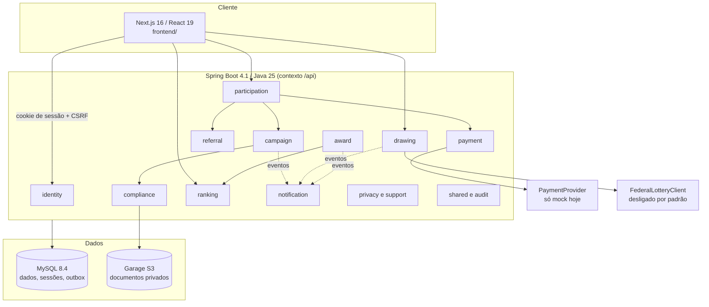
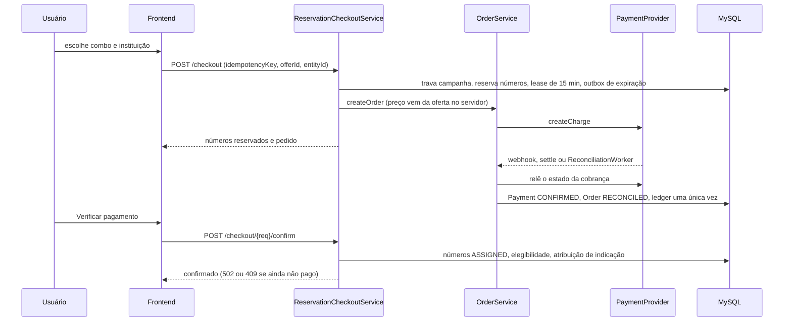
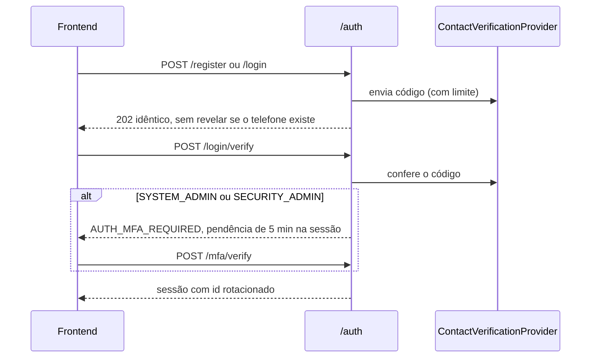
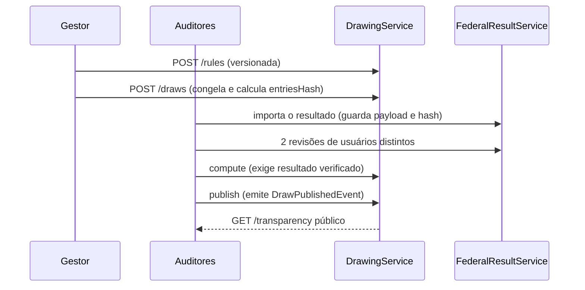

# Mapa do Codebase

> Gerado pelo Cartographer. Último mapeamento: 2026-11-03T21:24:30Z, na branch `feature/combos-minimo-5`.
> Escopo: arquivos versionados no git; a pasta `campanha_01/` ficou de fora. `total_tokens` é uma estimativa (bytes ÷ 4), pois o `tiktoken` não estava disponível.
> Nenhum teste foi executado neste mapeamento.

## Visão geral do sistema

Plataforma de arrecadação com números, sorteio e prêmios. É um monólito modular Spring Boot com frontend Next.js e MySQL como único banco e fila (outbox). Estado atual: **MVP em modo DEMO**, com `app.live-operations-enabled=false` e PSP simulado (`MockPaymentProvider`).



## Estrutura de diretórios

```text
.
├── AGENTS.md                 # contrato de execução dos agentes
├── IMPLEMENTATION_PLAN.md    # marcos P00–P20
├── JAVA-ENGINEERING-GUIDE.md # premissas de engenharia Java
├── compose.yaml              # stack de staging/DEMO, sem portas no host, com Cloudflare Tunnel
├── compose.build.yaml        # override com build local das imagens
├── pom.xml                   # agregador Maven (só backend)
├── backend/                  # API; pacote la.meleva.fundraiser
│   └── src/main/resources/db/migration/  # Flyway V001–V025
├── frontend/                 # Next.js; rotas em src/app, testes em tests/e2e
├── infrastructure/           # compose local (MySQL, Mailpit, Garage)
├── scripts/                  # check-all, s3-init, backup-mysql
├── docs/                     # adr, api, architecture, compliance, operations, progress, security
└── .github/workflows/        # backend.yml, images.yml
```

## Guia de módulos do backend

Base: `backend/src/main/java/la/meleva/fundraiser/`.

### identity

**Propósito**: cadastro, login por código, sessão, MFA de administradores e papéis.
**Endpoints**: `POST /auth/{register,login,login/verify,verify-contact,mfa/verify,logout}`, `GET /auth/me`, `POST|DELETE /_cx/memberships`.
**Papéis** (`UserRole`): VISITOR, PARTICIPANT, PROMOTER, SUPPORT, CAMPAIGN_MANAGER, FINANCE, COMPLIANCE_REVIEWER, DRAW_AUDITOR, SECURITY_ADMIN, SYSTEM_ADMIN.
**Arquivos-chave**: `MfaService`, `LoginAttemptTracker`, `ContactVerificationProvider`, `MockContactVerificationProvider`, `DemoMfaCodeVerifier`, `IdentityAdministrationController`.

### campaign

**Propósito**: ciclo de vida, modos e capacidades da campanha.
**Endpoints**: `/campaigns` (CRUD, `slug/{slug}`, `{id}/transition`, `{id}/prizes`).
**Arquivos-chave**: `CampaignService`, `CampaignStateMachine`, `CapabilityPolicy`, `AdminGateMatrix`.
**Estados**: DRAFT → LEGAL_REVIEW → AUTHORIZED → SCHEDULED → OPEN → LOCKED → DRAW_PENDING → DRAWN → AWARDS_PENDING → CLOSED. Também há LEGAL_REVIEW → DRAFT, OPEN ↔ SUSPENDED e CANCELLED a partir de DRAFT, LEGAL_REVIEW, AUTHORIZED, SCHEDULED e SUSPENDED.
**Gates por modo**: DEMO não exige gates. COMMERCIAL_PROMOTION exige LEGAL, SECURITY, OPERATIONS e LAUNCH. PHILANTHROPIC_AUTHORIZED e CAPITALIZATION_PRIZE_TITLE exigem todos.

### compliance

**Propósito**: documentos privados, regulamento, autorizações e aprovações de gates.
**Endpoints**: `/_cx/campaigns/{id}/{documents,regulations,authorizations}`, `.../authorizations/{id}/verify`, `.../documents/{id}/private-content`.
**Arquivos-chave**: `ComplianceDocumentService` (até 10 MB; PDF, JPEG, PNG), `ApprovalService`, `AuthorizationService`, `PrivateDocumentStorage` (implementações em memória e S3).

### participation

**Propósito**: estoque de números, reservas, checkout, atribuição, congelamento, combos, beneficiários, carga inicial de prêmios e "meus números".
**Endpoints** (`/participations/campaigns/{id}`): `POST /`, `GET /numbers/mine`, `GET /availability`, `GET /numbers`, `POST /freeze`, `GET|POST /offers`, `POST /checkout`, `POST /checkout/{req}/confirm`, `GET|POST /beneficiaries`, `/numbers/prize-load` (com `/export` e `/verify`). Também `GET /campaigns/public/{id}`.
**Arquivos-chave**: `ReservationCheckoutService`, `ReservationService`, `NumberAllocator`, `ParticipationService`, `ReservationExpiryWorker`, `RefundedParticipationHandler`, `InitialPrizeLoadService`, `MyNumbersService`, `purchase/`, `beneficiary/`.
**Estados do número**: AVAILABLE, RESERVED, ASSIGNED, FROZEN, INVALIDATED.

### payment

**Propósito**: pedidos, cobranças, webhooks, conciliação, estornos, ledger e relatórios financeiros.
**Endpoints**: `POST /payments/orders`, `POST /payments/webhooks/mock`, `POST /payments/mock/orders/{id}/settle` (só `local` e `staging`), `/financial/campaigns/{id}/{reports,reports/export,simulations}`, `/financial/organizations/{id}/reports`.
**Arquivos-chave**: `OrderService`, `PaymentProvider`, `MockPaymentProvider`, `DisabledLivePaymentProvider`, `ReconciliationWorker`, `FinancialAccessService`.

### referral

**Propósito**: links de divulgação, cliques e atribuição de vendas.
**Endpoints** (`/referrals/campaigns/{id}`): `POST /link`, `POST /click/{code}`, `GET /metrics`.
**Regras**: só indica quem já tem número na campanha; autoindicação é rejeitada; a atribuição ocorre no `confirm`, depois do pagamento.

### ranking

**Propósito**: placares PROMOTER e PARTICIPANT, com snapshots lacrados por hash e pseudônimos (iniciais + 4 últimos dígitos do telefone).
**Endpoints** (`/rankings/campaigns/{id}`): `GET /{scope}`, `POST /rules`, `POST|GET /snapshots`, `GET /snapshots/{id}`, `GET /snapshots/{id}/export`.
**Arquivos-chave**: `RankingService`, `RankingCalculator`, `RankingQueries`, `RankingPseudonymizer`.
**Desempate**: maior pontuação, depois primeiro fato mais antigo, depois `publicId`.

### drawing

**Propósito**: apuração determinística com base na Loteria Federal e compromisso SHA-256 dos prêmios-surpresa.
**Endpoints**: `/drawings/campaigns/{id}/{rules,draws,draws/{d}/compute,draws/{d}/publish,draws/{d}/transparency}`, `/drawings/federal-results`, `/surprises/campaigns/{id}/{commitment,enable,reveal,reveal-approvals,verify}`.
**Arquivos-chave**: `DrawingService`, `DrawingEngine` (puro), `FederalDrawRule`, `FederalResultService`, `SurpriseCommitmentService`, `SurpriseProof`, `SurpriseSecretCipher`.
**Estados do sorteio**: PENDING → RESULTS_IMPORTED → COMPUTED → PUBLISHED.

### award

**Propósito**: entrega simulada de prêmios não monetários, com origem na apuração ou no ranking. Prêmio em dinheiro é sempre bloqueado (`AwardTransferPolicy`).
**Estados**: PENDING_VERIFICATION → VALIDATED → SCHEDULED → DELIVERED; DISPUTED é terminal.
**Endpoints**: nenhum.

### notification

**Propósito**: outbox de notificações, sem PII no evento.
**Arquivos-chave**: `NotificationEnqueuer`, `NotificationWorker`, `DemoNotificationProcessor`, `NotificationTemplate`, `RecordingOnlyNotificationTransport` (padrão, não envia nada), `MailpitNotificationTransport`.
**Endpoints**: `GET|PUT /notifications/preferences`.

### privacy, support, audit e shared

- **privacy**: exportação, anonimização e CPF cifrado (`/privacy/me/{export,anonymize,cpf}`; AES-GCM + índice HMAC).
- **support**: `POST|GET /support/requests`.
- **audit**: `AuditEvent` e seu repositório.
- **shared**: `SecurityConfig`, `RateLimitFilter`, `ErrorCode`, `GlobalExceptionHandler`, `Money`, `PhoneNumbers`, `LocalDemoSeed`.

### Migrações (`backend/src/main/resources/db/migration`)

| Versão | Conteúdo |
|---|---|
| V001–V002 | identidade; campanha e compliance |
| V003–V004 | participação; pagamentos |
| V005–V007 | referral, ranking, sorteio, auditoria; outbox e inbox; sessões |
| V008–V011 | verificação de telefone e MFA; limite por campanha; unicidade do ledger; snapshots de ranking |
| V013–V016 | segredo do compromisso; flag de surpresa; aprovações de revelação; evidência de entrega |
| V017–V020 | preferências de notificação; suporte; fluxo de compra; carga de prêmios |
| V021–V025 | revisões do resultado federal; CPF; publicação do compromisso; prêmios por posição; limites de combo |

## Frontend

Next.js 16 (App Router, `output: standalone`), React 19, TypeScript strict, Tailwind 4, Playwright. O `frontend/AGENTS.md` manda ler `node_modules/next/dist/docs/` antes de codar.

| Rota | Tipo | Propósito |
|---|---|---|
| `/` | Server | Landing |
| `/participar` | Client | Compra em 4 passos: combo, instituição, cadastro, Pix |
| `/meus-numeros` | Client | Números do usuário logado |
| `/indicar` | Client | Link, QR e métricas de indicação |
| `/numeros` | Client | Grade de números (dados simulados no cliente) |
| `/rankings` | Client | Placares |
| `/apuracao` | Client | Transparência do sorteio |
| `/transparencia` | Client | Verificação da carga de prêmios e surpresas |
| `/faq`, `/regulamento` | Server | Texto estático |
| `/contribua/*` | Client | Painel: dashboard, ofertas, beneficiários, pagamentos, compliance, sorteio, relatórios |

**Arquivos-chave**: `src/lib/api-client.ts` (fetch com cookie e CSRF), `src/lib/campaign-config.ts` (valores fixos), `src/lib/use-auth.ts`, `src/lib/use-campaign-state.ts` (CTA em fail-closed), `src/components/code-login-form.tsx`.

## Fluxos de dados

### Compra



Sem pagamento, `ReservationExpiryWorker` libera os números. Um estorno publica `PaymentRefundedEvent`, e `RefundedParticipationHandler` invalida as entradas.

### Autenticação



### Apuração



**Prêmios-surpresa**: o compromisso (hash do sal + JSON canônico) é publicado com a campanha em DRAFT, e o segredo fica cifrado. A revelação exige sorteio publicado com evidência e duas aprovações de usuários distintos, nos papéis DRAW_AUDITOR e COMPLIANCE_REVIEWER, nenhum deles o criador.

## Convenções

- **Dinheiro**: `long` em centavos, moeda BRL (`Money`, ADR-0004).
- **Horários**: UTC no banco; `RankingQueries` e as inserções em lote convertem explicitamente.
- **Erros**: `shared/ErrorCode` + `toException()`, resposta `problem+json`.
- **Idempotência**: chave UUID no checkout, `inbox_events` em webhooks, unicidade `(source_ref, entry_type)` no ledger.
- **Filas**: tabela `outbox_events` com workers; alocação de números usa lock pessimista, sem `SKIP LOCKED`.
- **Autorização**: `@PreAuthorize` no controller e nova checagem de membership por organização no serviço.
- **Banco**: Flyway forward-only, `ddl-auto=validate`.
- **Frontend**: Tailwind inline com variáveis CSS; UI em pt-BR. Nomes como `midnight` e `ember` são aliases legados da paleta.
- **Branches**: nunca commitar direto na `main`.

## Guia de navegação

| Para... | Mexa em |
|---|---|
| Adicionar endpoint | Controller e service do módulo; regra pública em `shared/SecurityConfig`; `ErrorCode` se houver erro novo; `docs/api/` |
| Mudar o schema | Nova migração em `db/migration` (próximo número livre, hoje V026) e a entidade correspondente |
| Mudar o fluxo de compra | `participation/ReservationCheckoutService`, `ReservationService`, `payment/OrderService`, `frontend/src/app/participar/page.tsx` |
| Integrar um PSP real | Nova implementação de `payment/PaymentProvider`; revisar a exigência de `MOCK` no `confirm` e no estorno (requer aprovação humana) |
| Mudar combos e preços | `participation/purchase/`, `frontend/src/components/combo-cards.tsx` |
| Mudar autenticação | `identity/`, `shared/SecurityConfig`, `frontend/src/lib/use-auth.ts` |
| Mudar transições ou gates | `campaign/CampaignStateMachine`, `CampaignService`, `AdminGateMatrix`, `CapabilityPolicy` |
| Mudar rankings | `ranking/RankingQueries`, `RankingCalculator`, `RankingService` |
| Mudar a apuração | `drawing/FederalDrawRule`, `DrawingEngine`, `DrawingService` |
| Adicionar notificação | `notification/NotificationTemplate`, `NotificationEnqueuer` |
| Adicionar página | `frontend/src/app/<rota>/page.tsx`, `frontend/src/lib/api-client.ts` |

## Comandos

```bash
docker compose -f infrastructure/compose.local.yaml up -d
cd backend && SPRING_PROFILES_ACTIVE=local ./mvnw spring-boot:run
cd frontend && npm install && npm run dev
./scripts/check-all.sh
```

O backend local também precisa de variáveis adicionais, listadas em `docs/operations/local-mvp.md`.

## Documentação relacionada

- Decisões: `docs/decisions.md`, `docs/adr/` (0001–0010)
- Domínio e dados: `docs/architecture/domain.md`, `docs/architecture/schema.md`
- Operação: `docs/operations/`
- Segurança: `docs/security/`
- Compliance: `docs/compliance/gates-status.md`
- Progresso: `docs/progress/`, `IMPLEMENTATION_PLAN.md`
