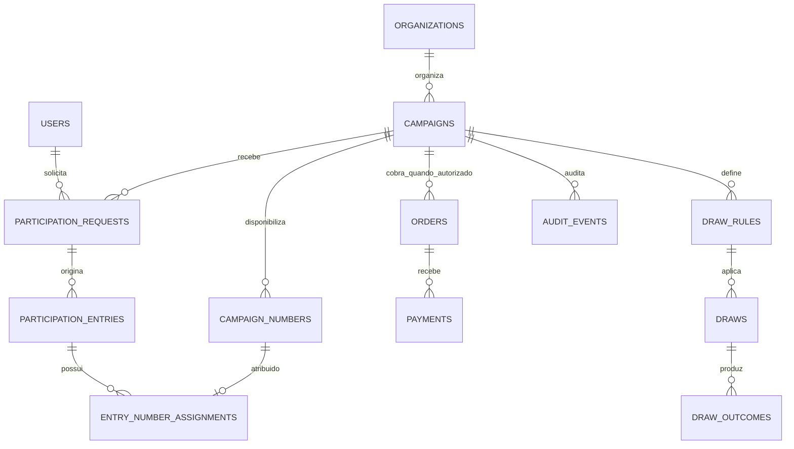

# Schema, capacidade e índices

## Visão relacional

## Dimensionamento inicial

Uma campanha pode ter até 100.000 registros em `campaign_numbers`. As tabelas de eventos (`audit_events`, `outbox_events`, `inbox_events`, pagamentos e cliques) crescem continuamente e devem ser acompanhadas por campanha, estado e período. Valores monetários usam `BIGINT` em centavos e UTC é obrigatório nos timestamps.

## Política de índices

- Integridade é garantida por chaves únicas e FKs, inclusive `campaign_numbers(campaign_id, series_code, number_value)` e eventos de inbox por fonte.
- Consultas operacionais usam os índices por campanha/usuário, campanha/status e fila `(status, available_at)` já definidos nas migrações.
- Índices novos exigem `EXPLAIN`, consulta que os utiliza e migração Flyway forward-only; não remover índices em produção sem medição documentada.
- `FOR UPDATE SKIP LOCKED` fica restrito às consultas da fila outbox/inbox. Rankings e apuração usam snapshots consistentes.

## Backup e recuperação

Produção requer backup criptografado, imutável e restauração periódica comprovada antes de afirmar RPO/RTO. No desenvolvimento, a recuperação é por recriação do banco e aplicação das migrações Flyway. Não existe procedimento de rollback destrutivo: uma correção é sempre uma nova migração forward-only ou restauração aprovada.
